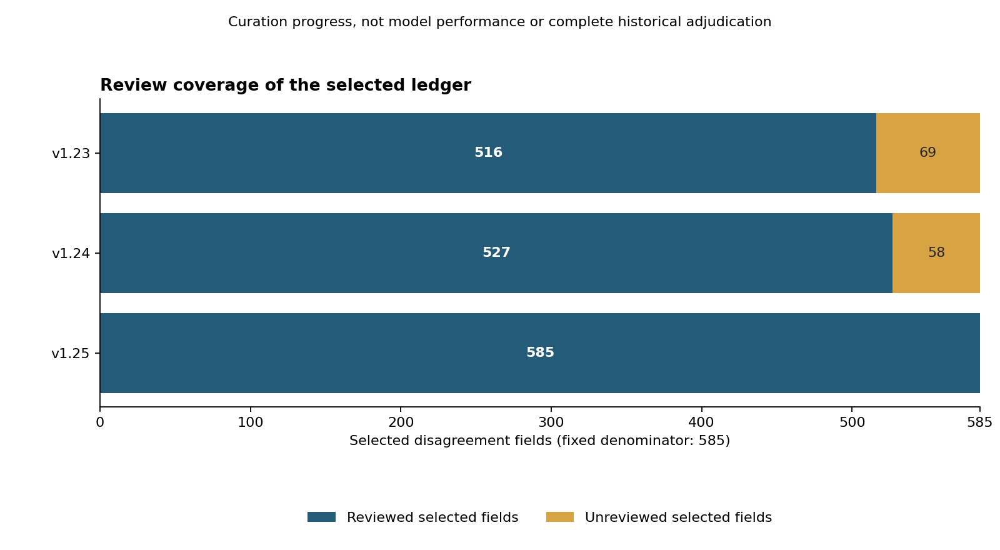

> **Evidence correction record:** The historical documentary narratives below are retained for context and qualified by the [V1 errata](../corrections/V1_ERRATA.md), the 28 claim dispositions and the 42-entry missing-source register. Availability of this record in a GitHub version is not a merge/publication receipt, owner authorization or verification of an external article correction. Derived documentary agreement and invented controls do not establish recovery or replay of original requests, outputs or historical proof bodies.

---

# Selected results and failure modes

These are historical observations projected into newly curated data. The closure audit checked nine released editing rows against an actually recovered derived matrix. That independently checked agreement concerns derived records, not the unavailable original model responses, validator implementation or historical proof bodies. The original request, response and metrics bodies for the 42 marked provenance entries were not recovered in the bounded audit. Public readers can check this derived projection, not independently audit the original responses. [Claims](claims.json) record this distinction; [provenance](provenance.json) contains safe identity references.

## Bounded-edit observations

Each record concerns five supplied target substitutions. Admission counts and exact reference-file matches are different outcomes. UNKNOWN means no evaluable delivery; it is not zero semantic accuracy. Reference equality is an in-memory comparison, not five independently proven engineering fixes. All rows share fixture families; rescue conditions are not matched primary comparisons.

| Record | Historical model tag | Condition | Context | Delivery | Admitted / 5 | Exact reference matches / 5 |
| --- | --- | --- | ---: | --- | ---: | ---: |
| OBS-01 | gemma4:12b | main guarded | 32768 | no evaluable delivery | UNKNOWN | UNKNOWN |
| OBS-02 | gemma4:31b | main guarded | 16384 | evaluable proposal | 4 | 4 |
| OBS-03 | glm-4.7-flash:q4_K_M | main guarded | 32768 | evaluable proposal | 5 | 4 |
| OBS-04 | granite4.2:30b | main guarded | 16384 | no evaluable delivery | UNKNOWN | UNKNOWN |
| OBS-05 | qwen3.8:27b | main guarded | 32768 | evaluable proposal | 5 | 5 |
| OBS-06 | qwen3-coder:30b | main guarded | 32768 | evaluable proposal | 5 | 5 |
| OBS-07 | gemma4:31b | paired prompt; both constrained | 16384 | evaluable proposal | 0 | 0 |
| OBS-08 | gemma4:12b | separate reasoning-off rescue | 32768 | evaluable proposal | 0 | 0 |
| OBS-09 | granite4.2:30b | separate reasoning-off rescue | 16384 | evaluable proposal | 5 | 4 |

The [CSV](selected-edits.csv) includes every retained sampling option, output cap and evidence identity. OBS-01 through OBS-06 cover the six primary guarded records. OBS-07 is the earlier fixed-order Gemma31 constrained prompt; OBS-08 and OBS-09 are separate reasoning-off rescue records. No pooled score, best-model label or causal comparison is calculated.

## What the cases show

**Documentary account of admission and output form.** The retained records report zero then four admitted targets for the Gemma31 pair. The historical account attributes the earlier strict rejection to leading whitespace and the remaining later rejection to a declaration outside the statement grammar; the original validator/request/response bodies were not recovered for independent replay. Both prompts are recorded as constrained with shared options. Fixed order, one seed and one fixture prevent attributing the difference to the validation notice or declaring rejected text semantically incorrect.

**Admission does not establish behavior.** In the GLM primary and Granite rescue records, all five proposals were admitted but only four resulting files matched references. The retained matrix describes asynchronous property-access ordering and an envelope-versus-array result mismatch on the same selected target. The two cataloged historical proof bodies were not recovered; they were not independently rerun in the closure audit. These are narrow documentary descriptions, not independent behavioral verification of the unavailable historical outputs or proofs; no production execution is established by them.

**Reported historical text-validator boundary.** Retained historical documentation describes a researcher-constructed edit with a comment quoting old source text: it reports rejection by a text-pattern validator and a comment-removal control that changed admission without changing the tested local behavior. It also reports that the complete migration remained incomplete. The original validator/control source was not recovered or independently replayed. The separately recovered public illustrative control checks its own invented mechanism; it is neither historical proof nor a measured validator false-rejection rate.

**Reported historical mutant and separate illustration.** A retained documentary account reports that an auditor-constructed mutant passed historical checked inputs and failed a later second-input challenge: the reference required two rows and the mutant returned none. The original mutant/oracle source was not recovered or independently replayed. The recovered public illustrative control demonstrates its own finite coverage gap, not a rerun of that historical mutant. These constructed examples are not naturally emitted model responses. Original scores and source identities remain unchanged.

## Reconciliation coverage

[Coverage CSV](reconciliation-coverage.csv) separates field review from assessment-unit counts. v1.23: 69 unreviewed selected fields; v1.24: 58; v1.25: zero. The final ledger contains 585 selected fields, a 152-ID join and 152 bounded assessment units. The final 32 related assessment units reuse 89 earlier control groups and add no model observations. Full historical adjudication remains incomplete; remaining contextual questions concern entitlement, durable storage, transaction/transport guarantees and generalization.

The [figure manifest](../figures/manifest.json) defines the denominator and transformation. It is a curation-progress chart, not an accuracy chart. [Limitations](../limitations.md) apply to every result.
